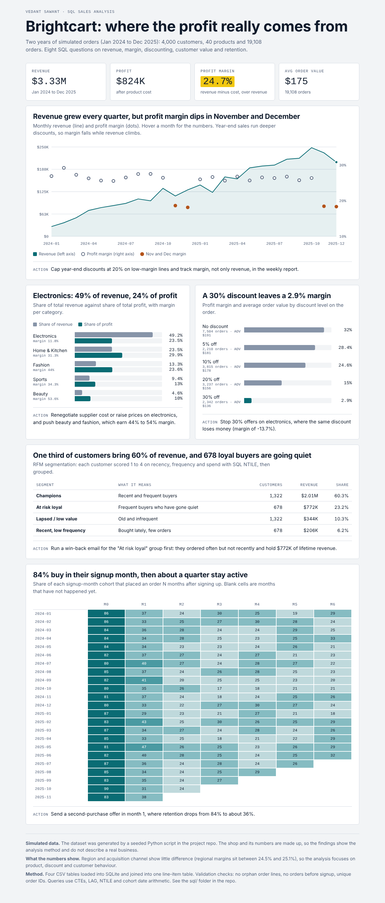

# Brightcart: E-commerce Sales Analysis (SQL)

**Live report:** https://vdntswnt.github.io/brightcart-sales-analysis/



A SQL analysis of two years of orders (Jan 2024 to Dec 2025) for a fictional online store: 4,000 customers, 40 products, 19,108 orders, 33,485 order lines.

> **The data is simulated.** `generate_data.py` creates it with a fixed random seed, so anyone can reproduce it. The business and its numbers are made up. The project demonstrates analysis method, not findings about a real company.

## Business questions
1. How do revenue and profit move month to month (LAG for growth)?
2. Which categories earn the profit, not just the revenue?
3. Does discounting pay for itself?
4. Do region or acquisition channel matter?
5. How concentrated is revenue among customers (NTILE deciles)?
6. Which customer segments exist (RFM scoring)?
7. How well are new customers retained (monthly cohorts)?
8. What share of customers buy again?

## Key findings
| Finding | Number |
|---|---|
| Revenue / profit / margin | $3.33M / $824K / 24.7% |
| Electronics share of revenue vs profit | 49.2% vs 23.5% (margin 11.8%) |
| Margin at no discount vs 30% discount | 32.0% vs 2.9% |
| Electronics margin on 30%-discount orders | -13.7% |
| Margin in Nov and Dec vs rest of year | 18.4% vs 26.3% (average discount 16.9% vs 7.5%) |
| Customers in the "Champions" RFM segment | 1,322 of 4,000 (33%), 60.3% of revenue |
| "At risk loyal" customers | 678 customers, $772K revenue |
| Customers active in signup month / month 1 | 84% / 36% |

## Recommendations
Cap year-end discounts at 20% on low-margin lines, fix electronics pricing or supplier cost, run a win-back campaign for "At risk loyal" customers, and send a second-purchase offer in month 1.

## Project layout
- `generate_data.py` creates the four CSVs in `data/`.
- `build_db.py` loads them into SQLite (`shop.db`), runs the SQL scripts and prints results.
- `sql/01_model.sql` builds the line-item table, `02_validate.sql` runs data checks, `03_analysis.sql` answers the questions (CTEs, window functions, cohort logic).
- `index.html` is the interactive readout (published at the live link above). Open it in a browser.
- `images/` holds the screenshot used in this README.

## Run it
```
pip install pandas numpy
python generate_data.py
python build_db.py
```

## Limits
Simulated data follows the patterns written into the generator (seasonality, discount levels, cost ratios), so results confirm that the SQL recovers them. With real data, check findings against business context before acting.

## Author
Vedant Sawant: [LinkedIn](https://www.linkedin.com/in/vdnt-swnt/) · [GitHub](https://github.com/vdntswnt)
